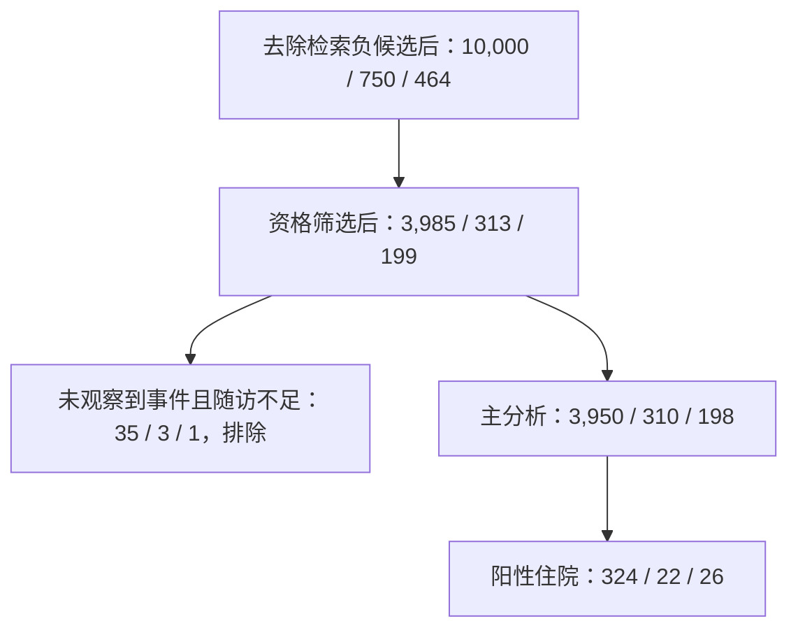
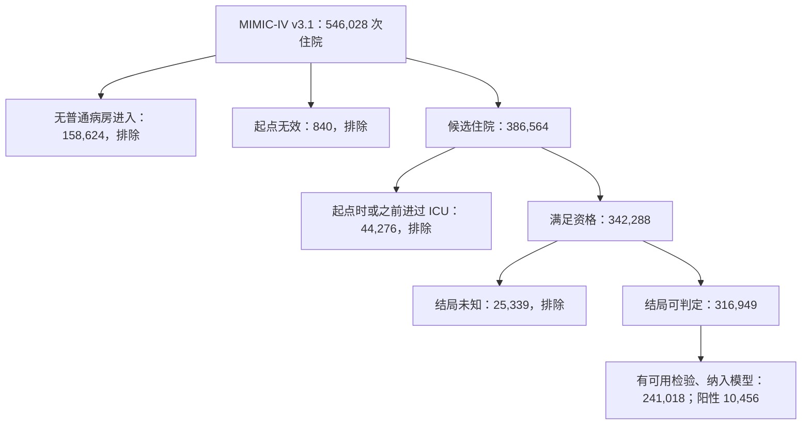

# DLCV 课程报告：胸片在 48 小时病房风险预测中的增量价值

## 摘要

主任务以普通病房正位胸片的拍摄时间为预测起点，预测同次住院接下来 48 小时内首次转入 ICU 或院内死亡。训练、验证和测试分别纳入 3,950、310 和 198 例住院，每例使用一张 Symile-MIMIC 预处理胸片。冻结的 ImageNet DenseNet121 将胸片编码为 1,024 维向量。测试集有 26 例阳性：仅胸片模型 AP 为 0.153，仅 ECG 和检验模型为 0.150，拼接模型为 0.188；四个预设配对差值的 95% 置信区间均跨零，尚不能确认胸片融合带来增益。

次任务以首次进入普通病房为预测起点，在较大的 MIMIC-IV 队列上建立实验室检验逻辑回归基线。入模 241,018 例，测试集 36,223 例，AP 为 0.110，AUROC 为 0.679。次任务不使用胸片，不是胸片实验的扩样验证；两任务的性能不作直接比较。

## 1. 主任务：胸片时点风险预测

### 1.1 数据与队列

Symile-MIMIC v1.0.0 [1] 使用 MIMIC-IV v2.2 [2]、MIMIC-IV-ECG v1.0 [3] 和 MIMIC-CXR-JPG v2.0.0 [4] 构建，原论文研究的是多模态表征学习与胸片检索 [5]。本实验仅沿用其胸片输入和对应关系，不使用 Symile 学习目标或发布的模型权重。主任务用 MIMIC-IV v3.1 的 `admissions` 确认住院能匹配、用 `transfers` 判定病房和 ICU 转入；入院、出院和死亡字段沿用 Symile 主表。次任务则直接使用 v3.1 的住院及转科记录 [6, 7]。

每次住院以一张正位（AP/PA）胸片的拍摄时间为预测起点。排除无法匹配住院、胸片不在住院时间内、死亡记录不一致或拍摄时已死亡、起点时或之前已进入 ICU，以及起点时无法确认唯一普通病房归属的记录。首次 ICU 转入或院内死亡落在 `(起点, min(起点 + 48 小时, 出院)]` 即为阳性；未观察到事件且随访覆盖不足记为 unknown，不当作阴性。原测试拆分用于胸片检索，每个查询只保留检索正配对；检索标签不是临床结局。

流程图计数按训练／验证／测试顺序排列，患者不跨集合。按上述资格规则顺序排除的住院数分别为 3/0/0、342/19/10、66/5/2、5,499/398/249、105/15/4。

### 1.2 特征与模型

- **胸片：**输入是已按 ImageNet 归一化的 320×320 RGB 张量 [1]，不是原始胸片。只做 224×224 中心裁剪，不重复归一化。使用冻结的 torchvision DenseNet121 [8]（`IMAGENET1K_V1` 权重 [9]），全局平均池化得到 1,024 维嵌入。
- **心电：**使用 Symile 对应的同患者 ECG，采集时间不晚于胸片。由 MIMIC-IV-ECG v1.0 波形 [3] 逐导联提取 7 项统计量，共 84 维；未独立验证采集时间是否晚于本次入院，因此不称为严格同次住院 ECG。
- **实验室检验：**从 MIMIC-IV v3.1 `labevents` 选取入院前后 24 小时内记录、且 `charttime ≤ storetime ≤ 起点` 的有限数值；每个（项目、单位）组合取最早的合格记录。面板由训练集选取 50 个组合，未独立核对标本类别。完整三模态住院数为 3,916/306/197；不完整记录以缺失指示参与。
- **模型：**比较仅胸片、仅 ECG＋检验、拼接、门控、门控（无模态 dropout）和门控多任务六个神经模型。使用 MLP 风险头、AdamW 和验证集 AP 选取训练轮次；另跑全模态 L2 逻辑回归，仅在训练和验证集上评估。

### 1.3 结果

本文统一用 AP（average precision）指代实验日志中标作 AUPRC 的非梯形插值指标。由于类别不平衡，AP 与 AUROC 一并报告，AP 以各自队列阳性率为参考 [10]。阈值在验证集按至少 90% 特异度的目标选取，测试集不保证达到该目标。

| 模型 | 验证 AP | 测试 AP | 测试 AUROC | 测试 Brier | 测试灵敏度 | 测试特异度 |
|---|---:|---:|---:|---:|---:|---:|
| 仅胸片 | 0.130 | 0.153 | 0.578 | 0.122 | 0.038 | 0.919 |
| 仅 ECG＋检验 | 0.132 | 0.150 | 0.530 | 0.132 | 0.192 | 0.855 |
| 拼接 | 0.133 | 0.188 | 0.588 | 0.120 | 0.115 | 0.878 |
| 门控 | 0.135 | 0.153 | 0.576 | 0.125 | 0.038 | 0.890 |
| 门控（无模态 dropout） | 0.163 | 0.148 | 0.559 | 0.127 | 0.077 | 0.878 |
| 门控多任务 | 0.138 | 0.166 | 0.559 | 0.124 | 0.077 | 0.901 |

固定测试集包含 198 例住院、26 例阳性。四项预设对比采用患者级配对 bootstrap（500 次）：

| 对比 | 测试 ΔAP | 95% CI |
|---|---:|---|
| 拼接 − 仅 ECG＋检验 | +0.038 | [−0.057, +0.124] |
| 门控 − 拼接 | −0.036 | [−0.096, +0.021] |
| 门控 − 门控（无模态 dropout） | +0.005 | [−0.016, +0.026] |
| 门控多任务 − 门控 | +0.014 | [−0.015, +0.091] |

拼接模型测试 AP 的点估计最高，但加入胸片后的 ΔAP 区间跨零，既不能确认存在增益，也不能据此排除增益。拼接模型在 AP 位胸片子组的 AP 为 0.199（141 例中 25 例阳性），在 PA 位子组为 0.021（57 例中仅 1 例阳性）；两组阳性率差异大，不能推断哪种视图更好。在 197 例完整模态测试住院中，拼接模型的四种模拟输入（全部模态、屏蔽 ECG、屏蔽检验、仅胸片）AP 为 0.187–0.190；这不证明其对真实缺失稳健。

全模态 L2 逻辑回归在训练集用患者分组五折交叉验证选得 `C=0.001`，验证 AP 为 0.180、AUROC 为 0.713、Brier 为 0.063。该模型未在胸片测试集上评分，不能与上表的测试成绩比较。

## 2. 次任务：首次进入普通病房时的实验室检验基线

### 2.1 队列

在 MIMIC-IV v3.1 [6, 7] 中以首次进入明确普通病房（16 个病房的白名单）为预测起点。排除起点时或之前已进入 ICU 的住院，沿用主任务的 48 小时复合终点和 unknown 判定规则。只有结局可判定且起点已有至少一个合格数值检验结果的住院入模。

在结局可判定的队列上按患者是否至少有一次阳性住院分层，固定种子 42，按约 70/15/15 划分患者。筛选可用检验后，实际入模分布如下；患者不跨集合。

| 集合 | 住院 | 患者 | 阳性住院 | 阳性患者 | 阳性率 |
|---|---:|---:|---:|---:|---:|
| 训练 | 168,123 | 84,412 | 7,281 | 6,611 | 4.33% |
| 验证 | 36,672 | 18,125 | 1,578 | 1,410 | 4.30% |
| 测试 | 36,223 | 18,055 | 1,597 | 1,442 | 4.41% |

### 2.2 特征与结果

检验需满足入院前后 24 小时且 `charttime ≤ storetime ≤ 起点`。匹配到同次住院的记录可纳入；无住院标识的记录只有在同患者且 `charttime` 早于入院时才可纳入。按训练集记录频次选择前 50 个（项目、单位）组合，其中 46 个为血液检验、4 个为尿液检验。每个组合先按 `charttime`、再按 `storetime` 取最早的合格结果。用训练集观测值估计均值和标准差；缺失值以训练均值填补，并加入缺失指示。

L2 逻辑回归按验证 AP 选得 `C=0.01`。验证集 AP 为 0.1082，AUROC 为 0.6902，Brier 为 0.0401。模型选定后仅在该任务测试集上评估一次：**AP 0.110、AUROC 0.679、Brier 0.0410**；AP 约为测试集阳性率 4.41% 的 2.5 倍。检验可用性可能带来选择偏倚；本模型不能代表起点无检验结果的人群，也未评估 ECG 的增量价值。

## 3. 讨论与后续工作

主任务样本来自满足 Symile 采样条件且在普通病房拍过胸片的住院；验证集和测试集分别只有 22 个和 26 个阳性。次任务在首次进入普通病房时预测，病例构成、可用模态和阳性率均不同。两个任务使用各自划分，但同源数据并不代表患者互斥；不把检验基线当作胸片模型的外部验证。两者均未区分计划性与非计划性 ICU 转入，终点不应直接等同于临床恶化。

下一步优先做一个只改胸片表征的对照：保持数据、冻结骨干和其他输入不变，比较 1×1 全局平均池化与 2×2 粗空间平均池化，灵感来自空间金字塔池化 [11]，但不是复现该方法。建议先在训练／验证集比较，并控制表示维度或预测头容量，避免把参数量变化误解为空间信息增益。该对照尚未运行；不使用现有测试集选方案。后续可考虑更大的胸片测试集、外部验证和严格同次住院 ECG 的增量分析。

## 4. 复现与共享范围

数据由 PhysioNet 提供 [12]；使用受限数据需满足对应访问协议。本报告只分享队列计数、汇总指标与方法，不分发病例级记录、胸片、波形、特征、预测或模型权重。主任务神经模型使用种子 42、至多 25 个训练轮次，阈值和模型选择均以验证集为依据。报告基于已有聚合结果；本次补充的[复现命令与依赖](README.md#reproduce-the-course-report)没有重新训练或重新评估受限真实数据，不能作为数值复验。README 中的原型流程和合成数据冒烟测试不对应本文的结果表。

## 参考文献

1. Saporta A, Puli AM, Goldstein M, Ranganath R. *Symile-MIMIC: a multimodal clinical dataset of chest X-rays, electrocardiograms, and blood labs from MIMIC-IV*. v1.0.0. PhysioNet, 2025. [DOI: 10.13026/3vvj-s428](https://doi.org/10.13026/3vvj-s428).
2. Johnson A, Bulgarelli L, Pollard T, Horng S, Celi LA, Mark R. *MIMIC-IV*. v2.2. PhysioNet, 2023. [DOI: 10.13026/6mm1-ek67](https://doi.org/10.13026/6mm1-ek67).
3. Gow B, Pollard T, Nathanson LA, et al. *MIMIC-IV-ECG: Diagnostic Electrocardiogram Matched Subset*. v1.0. PhysioNet, 2023. [DOI: 10.13026/4nqg-sb35](https://doi.org/10.13026/4nqg-sb35).
4. Johnson A, Lungren M, Peng Y, Lu Z, Mark R, Berkowitz S, Horng S. *MIMIC-CXR-JPG — chest radiographs with structured labels*. v2.0.0. PhysioNet, 2019. [DOI: 10.13026/8360-t248](https://doi.org/10.13026/8360-t248).
5. Saporta A, Puli AM, Goldstein M, Ranganath R. *Contrasting with Symile: Simple Model-Agnostic Representation Learning for Unlimited Modalities*. NeurIPS, 2024. [论文](https://proceedings.neurips.cc/paper_files/paper/2024/file/6828259348d99d5e8994028bfdf15d09-Paper-Conference.pdf).
6. Johnson A, Bulgarelli L, Pollard T, et al. *MIMIC-IV*. v3.1. PhysioNet, 2024. [DOI: 10.13026/kpb9-mt58](https://doi.org/10.13026/kpb9-mt58).
7. Johnson AEW, Bulgarelli L, Shen L, et al. *MIMIC-IV, a freely accessible electronic health record dataset*. Scientific Data, 2023;10:1. [DOI: 10.1038/s41597-022-01899-x](https://doi.org/10.1038/s41597-022-01899-x).
8. Huang G, Liu Z, van der Maaten L, Weinberger KQ. *Densely Connected Convolutional Networks*. CVPR, 2017. [论文](https://openaccess.thecvf.com/content_cvpr_2017/html/Huang_Densely_Connected_Convolutional_CVPR_2017_paper.html).
9. TorchVision. *densenet121: DenseNet121_Weights.IMAGENET1K_V1*. [模型文档](https://docs.pytorch.org/vision/stable/models/generated/torchvision.models.densenet121.html).
10. Saito T, Rehmsmeier M. *The Precision-Recall Plot Is More Informative than the ROC Plot When Evaluating Binary Classifiers on Imbalanced Datasets*. PLOS ONE, 2015;10(3):e0118432. [DOI: 10.1371/journal.pone.0118432](https://doi.org/10.1371/journal.pone.0118432).
11. He K, Zhang X, Ren S, Sun J. *Spatial Pyramid Pooling in Deep Convolutional Networks for Visual Recognition*. ECCV, 2014. [DOI: 10.1007/978-3-319-10578-9_23](https://link.springer.com/chapter/10.1007/978-3-319-10578-9_23).
12. Pollard T, Moody BE, Lehman LH, et al. *PhysioNet as a global platform for biomedical research*. Nature Health, 2026;1:792–795. [DOI: 10.1038/s44360-026-00096-z](https://doi.org/10.1038/s44360-026-00096-z).
