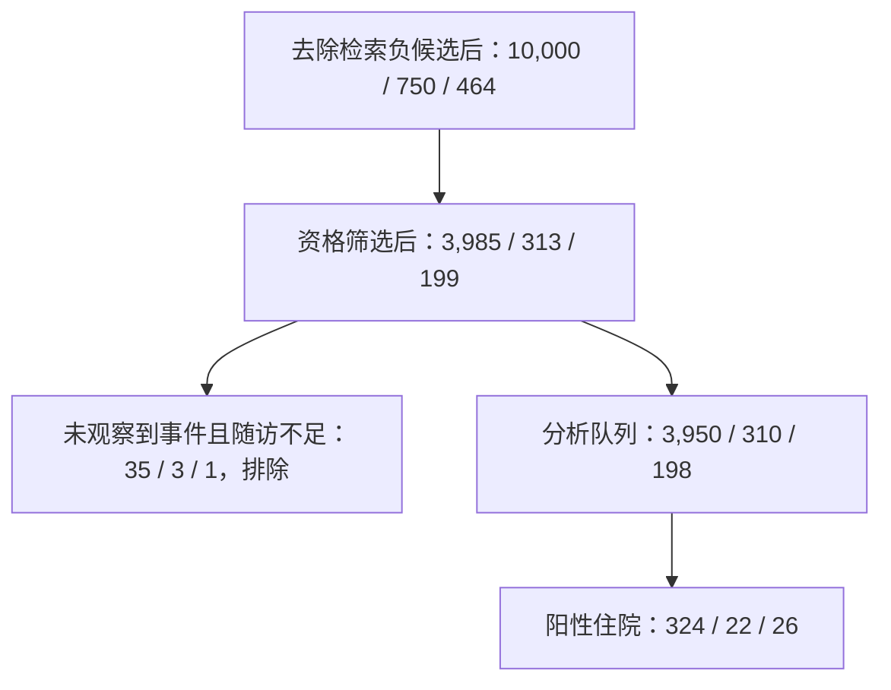
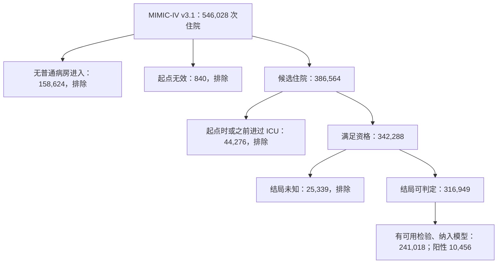

# DLCV 课程报告：胸片在 48 小时病房风险预测中的增量价值

## 摘要

本研究以普通病房正位胸片的拍摄时间为预测起点，预测同次住院接下来 48 小时内首次转入 ICU 或院内死亡。训练、验证和测试分别纳入 3,950、310 和 198 次住院。探索性配对分析固定队列、拍片时点和结局，在相同的 L2 逻辑回归流程中比较结构化基线，以及分别加入冻结 ImageNet 或 NIH 胸片预训练 DenseNet121 特征的模型。原测试集有 26 个事件（13.1%）；三组 AP 分别为 0.234、0.211、0.230，AUROC 分别为 0.662、0.653、0.672。更换为 NIH 表征后，AP 与 AUROC 点估计均高于 ImageNet 组，但两项配对区间均跨零；相对结构化基线也未建立可靠影像增益。分析复用已报告的测试集，且没有控制同期生命体征和氧疗。

## 1. 病房胸片队列与结局

Symile-MIMIC v1.0.0 [1] 整合 MIMIC-IV v2.2 [2]、MIMIC-IV-ECG v1.0 [3] 和 MIMIC-CXR-JPG v2.0.0 [4]，原用于多模态表征学习与胸片检索 [5]。Symile 在入院后 `(24, 72]` 小时选片，不是完整胸片清单，也不能代表急诊首片。本研究沿用其输入和对应关系，不使用其训练目标或发布权重；用 MIMIC-IV v3.1 `admissions` 确认住院匹配、用 `transfers` 判定病房与 ICU 转入 [6, 7]，队列的入院、出院和死亡时间沿用 Symile 主表。

每次住院以一张 AP 或 PA 位胸片的拍摄时间为起点。排除无法匹配住院、胸片不在住院时间内、死亡记录不一致或拍片时已死亡、起点时或之前已进入 ICU，以及起点时无法确认唯一普通病房归属的记录。首次 ICU 转入或院内死亡落在 `(起点, min(起点 + 48 小时, 出院)]` 即为阳性；未观察到事件且随访覆盖不足记为未知，不当作阴性。原影像检索测试拆分中每个查询只保留检索正配对；检索标签不是临床结局。

计数按训练／验证／测试顺序排列，对应 3,564／309／198 名患者，患者不跨集合。按上述资格规则顺序排除的住院数分别为 3/0/0、342/19/10、66/5/2、5,499/398/249、105/15/4。

## 2. 探索性分析：在相同结构化输入上加入胸片

### 2.1 输入与配对方法

- **检验：**复用历史真实缓存中的 50 个训练集选定的（项目、单位）组合。取入院前后 24 小时内最早的合格有限数值，要求 `charttime ≤ storetime ≤ 拍片`；无住院标识的检验仅在同患者且 `charttime` 早于入院时纳入。训练／验证／测试中至少有一项检验的住院数为 3,916／306／197。
- **ECG：**复用历史波形特征（12 导联各 7 项统计量）。用 MIMIC-IV-ECG 官方清单核对患者、记录标识和采集时间；仅在采集时间落入唯一的同次住院区间、且不晚于拍片时保留。符合条件的住院数为 921／78／51；其余在三组均记为缺失，不删病例。清单没有住院编号或独立录入时间，因此这是按时间归属核验，不是实时可用性验证。
- **投照位与像素：**三组均纳入 AP/PA。两种影像组使用完全相同的 Symile 张量和 224×224 中心裁剪，冻结 DenseNet121 [8]，对最后卷积特征图直接做全局平均池化得到 1,024 维向量（均不额外加 ReLU、不用分类头、不微调）。ImageNet 组 [9] 直接使用已归一化的 RGB 输入；NIH 组用 TorchXRayVision 的 NIH 专用胸片权重 `densenet121-res224-nih` [15]，不使用含 MIMIC-CXR 的组合权重。先逆转 Symile 的 RGB 归一化，核验三个通道对应同一灰度，再取单通道并将像素从 `[0, 1]` 线性映射到 `[-1024, 1024]`。比较的是两种固定的影像特征提取流程，不能单独归因于预训练语料。

三组使用同一批住院、同一拍片时点和结局、相同的患者分组五折（种子 42）与 L2 逻辑回归。仅在各折训练部分拟合标准化，用训练均值填补缺失，并添加逐项检验及整条 ECG 的缺失指示。各组从相同的 `C` 网格（`0.0001, 0.001, 0.01, 0.1, 1`）按训练交叉验证平均 AP 分别选参。最终在原训练集拟合，验证集用于检查，不以测试结果选参。测试集比较两种影像流程各自相对结构化基线的差值，以及 NIH 相对 ImageNet 的直接差值；三项比较共用同一批患者配对 bootstrap 重抽样（2,000 次，种子 42），报告百分位 95% CI。

### 2.2 结果与解读

本文用 AP（average precision）表示实验日志中记为 AUPRC 的非梯形插值指标 [10]。测试阳性率为 13.1%，是无技巧 AP 的参考；AUROC 的随机参照是 0.50。测试集结果如下：

| 原测试集（198 次住院，26 个事件） | 选定 `C` | AP | AUROC | Brier |
|---|---:|---:|---:|---:|
| 检验＋时间核对的同次住院 ECG＋AP/PA | 0.01 | 0.234 | 0.662 | 0.112 |
| 相同输入＋ImageNet 胸片特征 | 0.001 | 0.211 | 0.653 | 0.114 |
| 相同输入＋NIH 胸片特征 | 0.001 | 0.230 | 0.672 | 0.113 |

| 测试集配对差（95% CI） | ΔAP | ΔAUROC |
|---|---:|---:|
| ImageNet 组 − 结构化基线 | −0.023 [−0.123, +0.048] | −0.009 [−0.115, +0.101] |
| NIH 组 − 结构化基线 | −0.004 [−0.128, +0.146] | +0.009 [−0.097, +0.122] |
| NIH 组 − ImageNet 组 | +0.019 [−0.066, +0.150] | +0.018 [−0.061, +0.092] |

验证集三组 AP 分别为 0.148、0.206、0.157，AUROC 分别为 0.644、0.731、0.653。NIH 组在测试集两项指标的点估计均高于 ImageNet 组，但验证集排序相反；所有测试配对区间都跨零。相对结构化基线，NIH 组的 AP 略低、AUROC 略高，不能判定有可靠的影像增益，也不能宣称等效。原测试集已在历史实验中使用，且只有 26 个事件；本分析不是独立验证。旧六模型见附录 A，其拼接与结构化组的模态 dropout 设置不完全相同，不能和本节差值合并解释。

## 3. 临床对照与局限

### 3.1 为什么没有 NEWS、MEWS 或 qSOFA 基线

| 评分 | 需要的输入与本研究的缺口 |
|---|---|
| NEWS / NEWS2 | 需要呼吸频率、SpO₂、是否补充氧、收缩压、心率、体温及意识状态；NEWS2 还纳入新发意识混乱。现有数据缺明确的室内空气／氧疗和同期意识评估，且不能验证生命体征在拍片时已可用，无法忠实计算。 |
| MEWS | 常见原始版本需要收缩压、心率、呼吸频率、体温和 AVPU（清醒、对声音有反应、对疼痛有反应、无反应）。本队列缺同期 AVPU 和覆盖足够的生命体征。MEWS 不应因缺氧疗而被排除，真正的缺口是其自身所需字段。 |
| qSOFA | 需要呼吸频率、收缩压及意识改变，用于疑似感染场景的风险提示，不是全人群病房恶化评分。缺同期意识和足够的拍片前生命体征，也未预先定义疑似感染人群。 |

本地病房覆盖审计中，即使只按急诊记录的 `charttime` 计算，拍片前窗口同时有呼吸频率和 SpO₂ 的也只有 49／3／2 次住院（各约 1%）。急诊生命体征表没有独立录入时间，也没有显式氧疗记录；SpO₂ 不能用来反推室内空气，未知不能作为正常或未吸氧。不用起点后的 ICU 记录回填，不计算缺项代理评分。原计划要求各集合至少 80% 的病例有可验证的呼吸频率、SpO₂ 和氧疗记录，未通过，因此没有运行含生命体征和氧疗的模型。本文的结构化对照不是临床预警评分，也不能回答控制同期生命体征和氧疗后的胸片增益。

### 3.2 文献对比

| 研究 | 人群、时点与性能 | 对本研究的启示 |
|---|---|---|
| Shamout 等，*npj Digital Medicine* [11] | COVID-19 阳性患者；独立患者的急诊测试集有 718 人、770 次检查、101 个 48 小时事件，终点包括插管、ICU 或院内死亡。临床模型 AUROC/PR AUC 为 0.739/0.325，集成模型为 0.749/0.332。 | 临床输入按拍片时点对齐，并纳入生命体征和氧疗；论文各模态报告样本不完全相同，表中分数差不是配对增量，也不能与普通病房直接比较。 |
| Edelson 等，*JAMA Network Open* [12] | 同一医疗系统七个院区，普通内外科病房；在相同观察时点预测 24 小时内直接转入 ICU 或病房死亡，NEWS AUROC 0.829，eCART 0.895。 | 动态病房评分的观察时点、结局和可用输入不同，不能用其 AUROC 作为本研究的合格线。值得借鉴的是同一时点比较及报告报警负担和提前量。 |
| Xie 等，*Scientific Data* [13] | MIMIC-IV-ED 成人就诊，以分诊为起点，测试 88,287 次就诊、5,126 个事件（5.8%）；终点为 ICU 在 12 小时内转入或院内死亡。逻辑回归 AUROC/AUPRC 为 0.864/0.321，ESI 为 0.804/0.194。 | 说明结构化临床基线值得建立，但这是不同场景、时点和终点，也不能从按就诊随机切分推断患者互斥。该研究也指出神经状态字段缺失，不可把不完整的评分当作本队列性能参照。 |

文献中的 PR AUC/AUPRC 沿用原文名称，不假定与本文 AP 的积分方式相同。原六模型的测试 AUROC 为 0.530–0.588、结构化神经模型 AP 0.150 仅比阳性率高约 0.019（附录 A）；这说明**原模型在这套队列与输入下的区分度偏弱**，不能说明任务本身没有可预测信号。本次配对结果也不支持靠更换融合结构就能得到稳定增益。

### 3.3 适用范围与下一步

队列只代表满足 Symile 选片及多模态采样条件、且在普通病房拍片的住院，不代表全部病房或急诊首片。终点不区分计划与非计划 ICU 转入，不能直接等同于可预防的临床恶化。下一步优先补足可验证的同期生命体征、氧疗和意识字段，并使用此前未参与模型选择的患者验证；不再用原测试集筛选影像表征。如要判断临床使用价值，还需在预设报警负担下评估灵敏度、阳性预测值和提前量。

### 3.4 急诊首张胸片：可行性审计，未训练模型

用完整 MIMIC-CXR-JPG 采集元数据 [4] 按患者和急诊停留时间匹配，在每次成人急诊就诊中选首张 AP/PA 胸片；预测时点是拍片，而非到院分诊。找到 79,474 次就诊（47,467 名患者）。对关联住院的就诊，核验从拍片后到 48 小时或出院（以先到者为准）的首次 ICU 转入或院内死亡；未关联住院且急诊观察不足 48 小时的记为未知。最终 54,317 次可判定（10,005 阳性、44,312 随访覆盖的阴性；可判定子集阳性率 18.4%），另有 25,157 次结局未知，不当作阴性。

在全部 79,474 次首片就诊中，按急诊 `charttime`，拍片前 2 小时同时记录呼吸频率和 SpO₂ 的有 38,519 次（48.5%），6 小时内为 44,218 次（55.6%）。急诊生命体征和分诊表没有显式氧疗状态或独立录入时间，仍不能验证拍片时的实际可用性。

完整元数据能定位首片，但本地像素仅覆盖 Symile 的选片子集。核验本地张量、同次住院与可判定结局后，只有 7 次急诊首片就诊同时满足这些条件，因此未训练急诊影像模型。该审计与上面的病房建模是不同人群，不能合并。

## 4. 复现与共享范围

数据由 PhysioNet 提供 [14]，须遵守相应访问协议。配对实验复用本地真实检验、ECG 和 ImageNet 特征缓存，并从相同胸片重新提取 NIH 特征；三组由 scikit-learn 1.3.0 重新拟合，结构化与 ImageNet 组的验证和测试指标与先前本地运行一致。只报告聚合结果，不分享病例级记录、胸片、波形、特征、预测或权重。[仓库复现命令与依赖](README.md#reproduce-the-course-report)对应历史实验，不包含这次探索性配对运行。合成冒烟测试验证了已知有增益和零增益两种情形，不是临床结果。

## 附录 A. 历史六模型结果

同一病房队列的历史实验比较六个神经模型：使用 MLP 风险头和 AdamW（种子 42，至多 25 个训练轮次），以验证集 AP 选训练轮次；阈值按验证集至少 90% 特异度的目标选取，测试集不保证达到该目标。历史 ECG 只核对同患者且采集不晚于胸片，没有验证同次住院归属；历史完整三模态住院数为 3,916／306／197。它不是第 2 节严格按时间核对 ECG 的配对分析。

| 模型 | 验证 AP | 测试 AP | 测试 AUROC | 测试 Brier | 测试灵敏度 | 测试特异度 |
|---|---:|---:|---:|---:|---:|---:|
| 仅胸片 | 0.130 | 0.153 | 0.578 | 0.122 | 0.038 | 0.919 |
| 仅 ECG＋检验 | 0.132 | 0.150 | 0.530 | 0.132 | 0.192 | 0.855 |
| 拼接 | 0.133 | 0.188 | 0.588 | 0.120 | 0.115 | 0.878 |
| 门控 | 0.135 | 0.153 | 0.576 | 0.125 | 0.038 | 0.890 |
| 门控（无模态 dropout） | 0.163 | 0.148 | 0.559 | 0.127 | 0.077 | 0.878 |
| 门控多任务 | 0.138 | 0.166 | 0.559 | 0.124 | 0.077 | 0.901 |

原固定测试集的四项预设对比采用患者级配对 bootstrap（500 次）：

| 对比 | 测试 ΔAP | 95% CI |
|---|---:|---|
| 拼接 − 仅 ECG＋检验 | +0.038 | [−0.057, +0.124] |
| 门控 − 拼接 | −0.036 | [−0.096, +0.021] |
| 门控 − 门控（无模态 dropout） | +0.005 | [−0.016, +0.026] |
| 门控多任务 − 门控 | +0.014 | [−0.015, +0.091] |

四项区间均跨零；验证阈值下拼接模型在测试集检出 3/26 个事件。拼接模型在 AP/PA 位子组的测试 AP 为 0.199/0.021（分别 141/57 例，25/1 个事件），不能用来推断哪种视图更好。197 例完整模态测试住院中的模拟屏蔽分析得到 AP 0.187–0.190，不证明对真实缺失稳健。历史全模态 L2 逻辑回归在训练五折选得 `C=0.001`，验证 AP 0.180、AUROC 0.713、Brier 0.063，未在测试集上评分。

## 附录 B. 独立实验：首次进入普通病房时的检验基线

这是与胸片分析不同的任务：以首次进入明确普通病房（16 个白名单病房）为起点，纳入结局可判定且至少有一个合格检验结果的住院，不要求拍胸片。其人群、起点和模态不同，且无法从同源数据推断与胸片队列患者互斥；**不是胸片实验的对照、扩样或外部验证**。

在 MIMIC-IV v3.1 [6, 7] 中排除起点时或之前已进入 ICU、起点无效或无明确普通病房进入的住院。沿用 48 小时复合终点和未知结局判定规则。

在结局可判定的队列上按患者是否至少有一次阳性住院分层，固定种子 42，按约 70/15/15 划分患者，再筛选可用检验。患者不跨集合。

| 集合 | 住院 | 患者 | 阳性住院 | 阳性患者 | 阳性率 |
|---|---:|---:|---:|---:|---:|
| 训练 | 168,123 | 84,412 | 7,281 | 6,611 | 4.33% |
| 验证 | 36,672 | 18,125 | 1,578 | 1,410 | 4.30% |
| 测试 | 36,223 | 18,055 | 1,597 | 1,442 | 4.41% |

检验需满足入院前后 24 小时且 `charttime ≤ storetime ≤ 起点`。匹配到同次住院的记录可纳入；无住院标识的记录只有在同患者且 `charttime` 早于入院时才可纳入。按训练集记录频次选择前 50 个（项目、单位）组合，其中 46 个为血液检验、4 个为尿液检验。每个组合先按 `charttime`、再按 `storetime` 取最早的合格结果。标准化及缺失填补统计量在训练集估计，并加入缺失指示。

L2 逻辑回归按验证 AP 选得 `C=0.01`。验证集 AP 为 0.1082、AUROC 为 0.6902、Brier 为 0.0401。测试集 AP 为 0.110、AUROC 为 0.679、Brier 为 0.0410；AP 约为测试集阳性率的 2.5 倍。结果不代表起点没有可用检验的人群，也未评估 ECG 的增量价值。

## 参考文献

1. Saporta A, Puli AM, Goldstein M, Ranganath R. *Symile-MIMIC: a multimodal clinical dataset of chest X-rays, electrocardiograms, and blood labs from MIMIC-IV*. v1.0.0. PhysioNet, 2025. [DOI: 10.13026/3vvj-s428](https://doi.org/10.13026/3vvj-s428).
2. Johnson A, Bulgarelli L, Pollard T, Horng S, Celi LA, Mark R. *MIMIC-IV*. v2.2. PhysioNet, 2023. [DOI: 10.13026/6mm1-ek67](https://doi.org/10.13026/6mm1-ek67).
3. Gow B, Pollard T, Nathanson LA, et al. *MIMIC-IV-ECG: Diagnostic Electrocardiogram Matched Subset*. v1.0.0. PhysioNet, 2023. [DOI: 10.13026/4nqg-sb35](https://doi.org/10.13026/4nqg-sb35).
4. Johnson A, Lungren M, Peng Y, Lu Z, Mark R, Berkowitz S, Horng S. *MIMIC-CXR-JPG — chest radiographs with structured labels*. v2.0.0. PhysioNet, 2019. [DOI: 10.13026/8360-t248](https://doi.org/10.13026/8360-t248).
5. Saporta A, Puli AM, Goldstein M, Ranganath R. *Contrasting with Symile: Simple Model-Agnostic Representation Learning for Unlimited Modalities*. NeurIPS, 2024. [论文](https://proceedings.neurips.cc/paper_files/paper/2024/file/6828259348d99d5e8994028bfdf15d09-Paper-Conference.pdf).
6. Johnson A, Bulgarelli L, Pollard T, et al. *MIMIC-IV*. v3.1. PhysioNet, 2024. [DOI: 10.13026/kpb9-mt58](https://doi.org/10.13026/kpb9-mt58).
7. Johnson AEW, Bulgarelli L, Shen L, et al. *MIMIC-IV, a freely accessible electronic health record dataset*. Scientific Data, 2023;10:1. [DOI: 10.1038/s41597-022-01899-x](https://doi.org/10.1038/s41597-022-01899-x).
8. Huang G, Liu Z, Van Der Maaten L, Weinberger KQ. *Densely Connected Convolutional Networks*. CVPR, 2017. [论文](https://openaccess.thecvf.com/content_cvpr_2017/html/Huang_Densely_Connected_Convolutional_CVPR_2017_paper.html).
9. TorchVision. *densenet121: DenseNet121_Weights.IMAGENET1K_V1*. [模型文档](https://docs.pytorch.org/vision/stable/models/generated/torchvision.models.densenet121.html).
10. Saito T, Rehmsmeier M. *The Precision-Recall Plot Is More Informative than the ROC Plot When Evaluating Binary Classifiers on Imbalanced Datasets*. PLOS ONE, 2015;10(3):e0118432. [DOI: 10.1371/journal.pone.0118432](https://doi.org/10.1371/journal.pone.0118432).
11. Shamout FE, Shen Y, Wu N, et al. *An artificial intelligence system for predicting the deterioration of COVID-19 patients in the emergency department*. npj Digital Medicine, 2021. [全文](https://pmc.ncbi.nlm.nih.gov/articles/PMC8115328/).
12. Edelson DP, et al. *Early Warning Scores With and Without Artificial Intelligence*. JAMA Network Open, 2024. [全文](https://pmc.ncbi.nlm.nih.gov/articles/PMC11544488/).
13. Xie F, et al. *Benchmarking emergency department prediction models with machine learning and public electronic health records*. Scientific Data, 2022. [全文](https://pmc.ncbi.nlm.nih.gov/articles/PMC9610299/).
14. Pollard T, Moody BE, Lehman LH, et al. *PhysioNet as a global platform for biomedical research*. Nature Health, 2026;1:792–795. [DOI: 10.1038/s44360-026-00096-z](https://doi.org/10.1038/s44360-026-00096-z).
15. TorchXRayVision. [`densenet121-res224-nih` 模型定义](https://github.com/mlmed/torchxrayvision/blob/master/torchxrayvision/models.py)及 [v1 官方 NIH 权重](https://github.com/mlmed/torchxrayvision/releases/download/v1/nih-densenet121-d121-tw-lr001-rot45-tr15-sc15-seed0-best.pt)（原文件 SHA-256：`31a5475c6b1383a7edbfcaf96af9ce302eb9969cfe28b6b8b5859afc6f274fdf`）。
